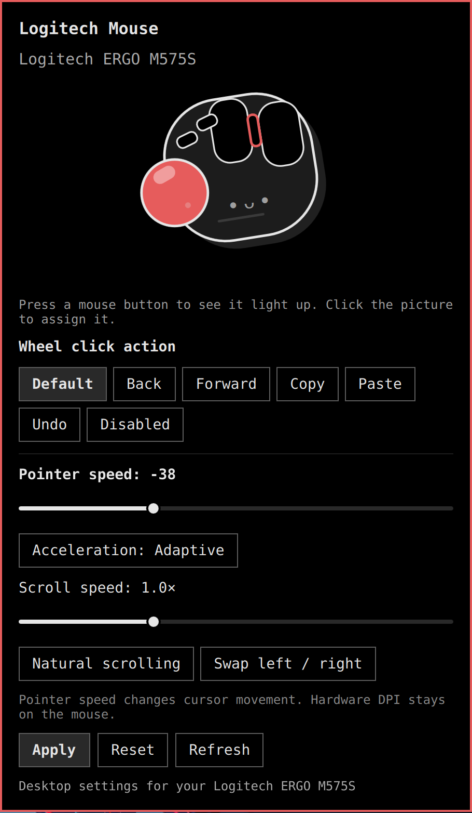

# Logitech Mouse for Omarchy

A small Omarchy taskbar pop-out for desktop mouse settings, with a playful ERGO-inspired trackball illustration. Click a button on the picture to choose its action, or press a physical mouse button to see the matching part flash.



## Compatibility and plans

**Tested: Logitech ERGO M575S on Omarchy Quattro with Hyprland 0.56.2.** The current release detects this model only. It supports its standard left, right, wheel, and two side-button events.

I will be testing and adding support for more Logitech mice as time passes, with future updates. Models will be documented as they are added and tested. Support for every Logitech model is not guaranteed.

This is an independent community project, not affiliated with Logitech. The cartoon is an original illustration, not an official product image.

## Controls

- Pointer speed and adaptive acceleration, or acceleration off.
- Scroll speed and natural scrolling.
- Swap left and right clicks.
- Wheel and side-button actions: Default, Back, Forward, Copy, Paste, Undo, or Disabled.
- An ERGO-style cartoon with physical button flashes and clickable controls.
- Settings saved locally and restored through Hyprland configuration.

Choose settings, then click **Apply**. **Reset** prepares standard defaults; click Apply to save them. Refresh discards unsaved changes and detects reconnections.

These are desktop settings. The plugin does not change hardware DPI, firmware, onboard profiles, polling rate, or proprietary mouse features.

## Requirements

- Omarchy Quattro with its Quickshell plugin system and Lua-based Hyprland configuration.
- Hyprland device-specific Lua bindings (`hl.device`, `hl.bind`). Tested with 0.56.2.
- Python 3, Git, and the existing `omarchy`, `omarchy-shell`, and `hyprctl` commands.
- A Logitech ERGO M575S connected through a normal Linux mouse input interface.

No additional Python modules, root access, raw input permissions, background daemon, or network service are required at runtime.

## Install

Add the plugin, then run its one-time desktop setup from an Omarchy terminal:

```bash
omarchy plugin add https://github.com/techguy-top/omarchy-mouse --enable
python3 ~/.config/omarchy/plugins/diky.mouse/install.py
```

**Running `install.py` explicitly authorizes the desktop configuration changes below.** Review the source before running it. It backs up the existing configuration, creates the mouse settings file, appends a two-line source hook to your personal Hyprland configuration, reloads Hyprland, and enables the bar widget beside the display controls. It leaves unrelated settings intact. Setup must be run once before the controls and physical button flashes work.

To install from a separate checkout instead:

```bash
git clone https://github.com/techguy-top/omarchy-mouse.git
cd omarchy-mouse
python3 install.py
```

The plugin uses these user-owned paths:

| Path under `~/.config/` | Purpose |
| --- | --- |
| `omarchy/plugins/diky.mouse/` | Installed plugin |
| `omarchy/mouse-profiles.json` | Saved mouse settings |
| `hypr/mouse-settings.lua` | Generated mouse settings and button bindings |
| `hypr/hyprland.lua` | Two-line source hook appended by setup |
| `omarchy/backups/mouse-*` | Backups created before setup |

Click Apply to update the generated settings and reload Hyprland. English strings are included; the panel uses Omarchy's translation fallback and follows the shell theme.

## Button behavior and limitations

Default button actions pass through to applications. Custom shortcuts consume the original click for the selected device and send the chosen key combination. Custom shortcuts run on an unmodified button press. Primary-button swapping uses Hyprland's left-handed mode, so left/right highlights may reflect logical buttons after swapping.

Animation IPC runs only while the panel is open. Bindings are created through normal configuration loading. The plugin retains no keybinding objects across reloads and never removes them through runtime evaluation.

Linux input capabilities may advertise more buttons than a device physically has. Buttons that do not emit standard mouse events cannot be assigned here. Profiles use Hyprland device names; indistinguishable instances of the same model may share a profile. Other programs or user configuration can conflict with mouse shortcuts.

## Disable or uninstall

To hide the taskbar widget:

```bash
omarchy plugin disable diky.mouse
```

Applied mouse settings remain active when the widget is disabled. For full removal:

1. Remove the comment `-- Mouse panel desktop profiles (diky.mouse)` and the immediately following `dofile(...)` line for `mouse-settings.lua` from `~/.config/hypr/hyprland.lua`.
2. Run `hyprctl reload`, then `hyprctl configerrors` and confirm there are no errors.
3. Remove the plugin with `omarchy plugin remove diky.mouse`.
4. If no longer needed, delete `~/.config/hypr/mouse-settings.lua` and `~/.config/omarchy/mouse-profiles.json`. Backups can be kept for recovery.

## Development and validation

```bash
omarchy plugin validate .
python3 -m unittest discover -s . -v
```

`verify_live.py` is an optional developer check. It briefly changes the connected M575S's speed/scroll profile, verifies live scroll isolation and saved settings, then restores the original profile in a `finally` block. Do not run it while actively using the mouse. Hyprland's `devices.defaultSpeed` reports the hardware default, not applied pointer sensitivity.

The owner's M575S has been tested interactively. Automated checks cover input validation, device filtering, per-device generated bindings, default click pass-through, and rollback. They do not establish compatibility with untested hardware or every application.

## License

MIT. See [LICENSE](LICENSE).
